# ПОСЛЕДНИЙ СТРАЖ

Мрачная фэнтези экшен-RPG от первого лица для Android (Godot 4.3, 3D,
вертикальный экран, управление одной рукой свайпами).

Королевство пало за одну ночь, мёртвые встали в своих доспехах. Последний
Страж Зари идёт от разрушенной заставы к столице, комната за комнатой.

| Бой | Босс | Кат-сцена | Итог |
|---|---|---|---|
| 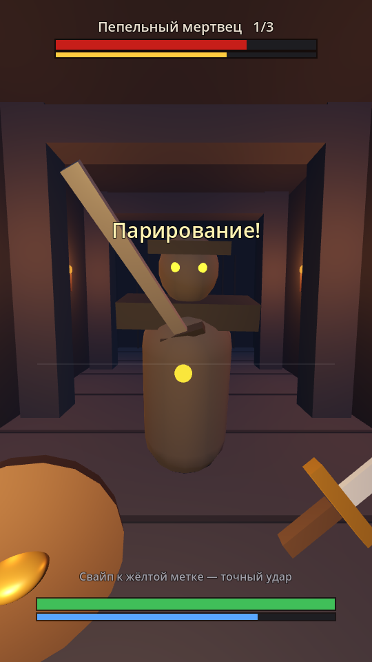 | 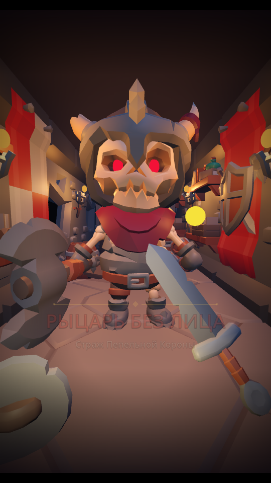 | 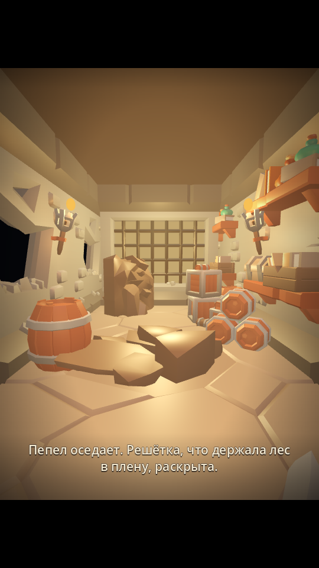 | 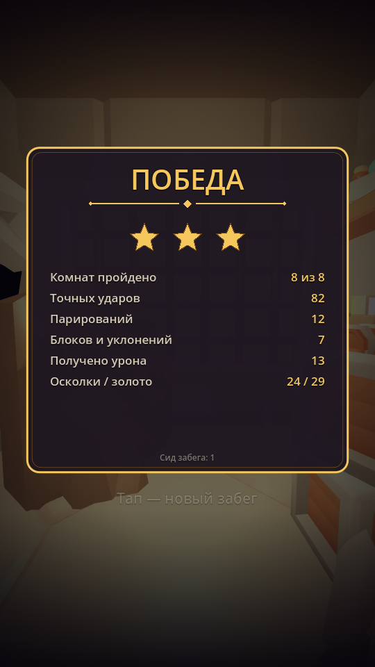 |

**Статус:** этап 1, забег из 7 комнат и босс «Рыцарь Без Лица» с кат-сценой победы. Графика — бесплатные CC0-модели KayKit
(см. `docs/CREDITS.md`), звук процедурный.

## Что уже работает
- Комната-коридор с колоннами и факелами, камера от первого лица, меч и щит в руках.
- Три врага по очереди: Пепельный мертвец, Мертвец-ветеран, Пепельный капитан.
- Враг показывает слабое место (жёлтая метка) и заранее замахивается: клинок
  краснеет, у края экрана стрелка. За 0.25 с до удара клинок и стрелка вспыхивают
  белым — это окно парирования.
- Стойкость врага: точные удары и парирования копят её → оглушение, урон ×2.
- Защита врага: после 2–3 ударов в стойке он сразу контратакует.
- Звук и вибрация на каждое действие.

## Управление (нижняя половина экрана)
| Жест | Действие |
|---|---|
| Свайп влево / вправо / вверх | Удар в эту сторону. В жёлтую метку — точный удар |
| Свайп навстречу удару в момент вспышки | Парирование |
| Свайп вниз | Щит (тратит стойкость при ударе) |
| Двойной свайп влево / вправо | Уклонение (не в сторону удара) |
| Удержать палец и отпустить | Заряженный удар ×2.5 |
| Тап после боя | Начать заново |

Все числа боя — в `data/combat.json`.

## Заставка и озвучка
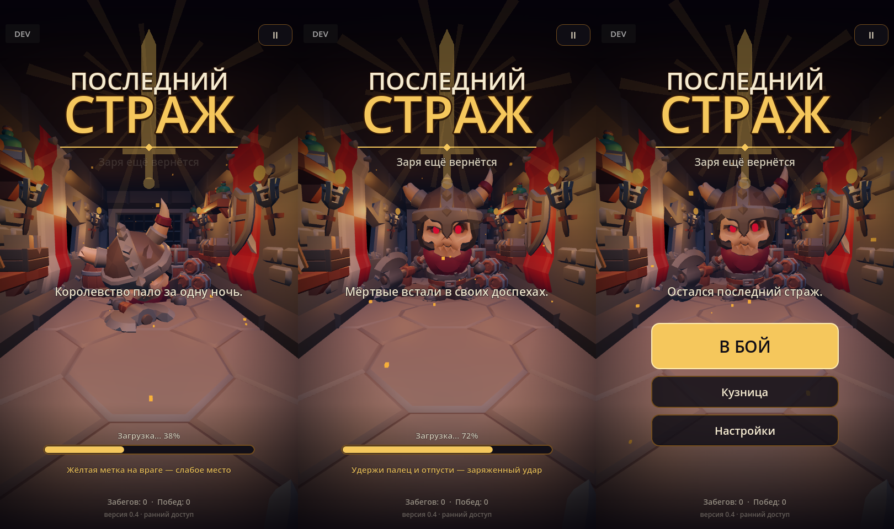

- При запуске: логотип по буквам, босс встаёт из земли в глубине коридора, искры,
  вступление рассказчика с субтитрами, загрузка с советами, меню «В бой / Кузница / Настройки».
- Озвучены вступление, босс (появление и обе смены фазы), кат-сцена победы и поражение.
  Субтитры показываются всегда. Тексты — `data/voice.json`.
- Фоновая музыка (CC0, OpenGameArt): меню, подземелье, бой, босс. Треки плавно сменяют
  друг друга и приглушаются под реплики. Громкость музыки — отдельный ползунок в паузе.

## Забег: дары, развилки, лавка, новые враги
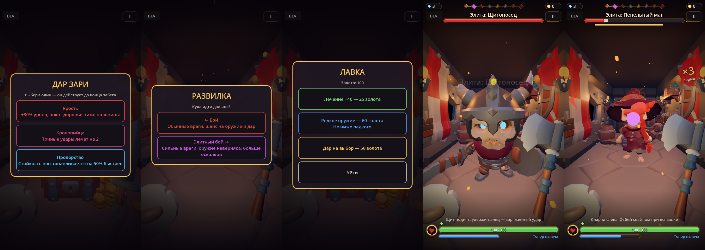

- **Дары:** после каждого боя — один из трёх на выбор, действует до конца забега
  (10 даров в `data/boons.json`: поджог критами, шипы на парирование, ярость, вампиризм и другие).
- **Развилки:** после комнаты можно свернуть на вторую дорогу — элитный бой или лавку.
- **Лавка:** лечение, редкое оружие и дар за золото.
- **Элитные бои:** враги крепче, зато оружие выпадает наверняка.
- **Новые враги:** щитоносец (обычные удары вязнут в щите — нужен заряженный),
  обманщик (на середине замаха меняет сторону), маг (пускает снаряд — отбей его обратно).

## Уровни, таланты и умения
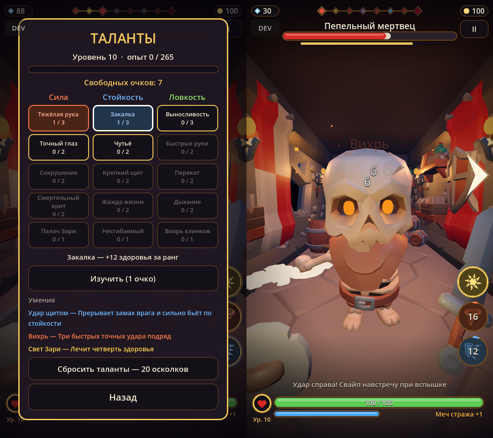

- **Опыт и уровень героя** сохраняются между забегами: опыт идёт за убийства, комнаты и босса.
  За каждый уровень — очко талантов. Уровень и полоска опыта видны под медальоном здоровья.
- **Таланты** (пауза **II** или главное меню → «Таланты»): три ветки по пять талантов —
  Сила, Стойкость, Ловкость. Изучаются сверху вниз; последний в ветке меняет стиль игры.
  Сброс — за 20 осколков.
- **Умения** — три кнопки справа в бою: «Удар щитом» (с 3 уровня) прерывает замах,
  «Вихрь» (с 6) — три точных удара, «Свет Зари» (с 10) лечит. У каждого своя перезарядка.
- Улучшения героя из кузницы убраны: купленные раньше возвращаются осколками.
  Кузница теперь только точит оружие — за осколки. Золото тратится в лавке.
- Все числа — в `data/hero.json`.

## Окно добычи и карточки с картинками
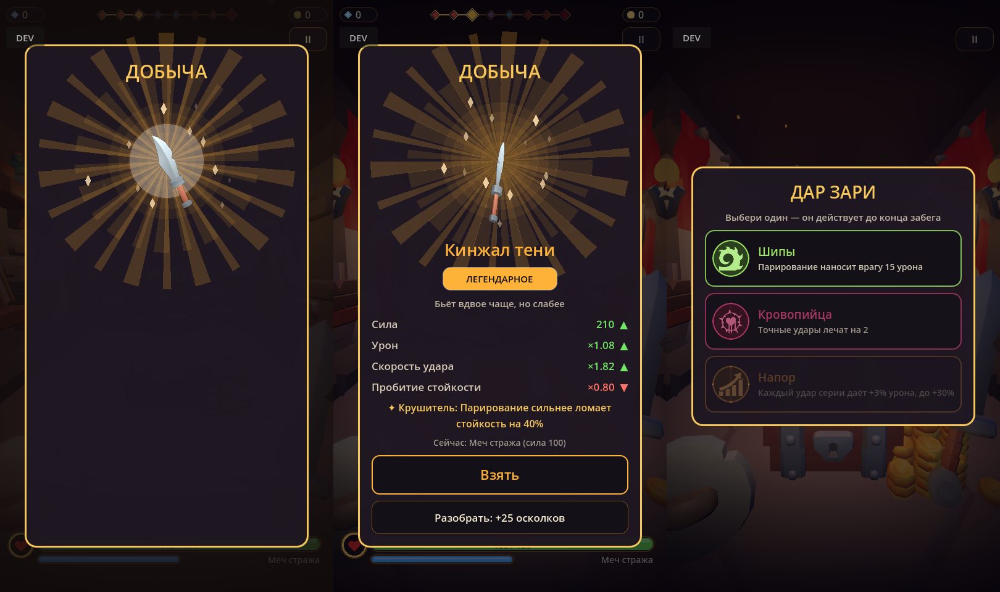

- **Выпадение оружия:** вспышка, лучи цвета редкости (у эпического и легендарного — два
  слоя), картинка оружия «выпрыгивает», раскручивается и покачивается, искры, строки сравнения
  появляются по очереди.
- **Дары, развилки, лавка:** карточки со значком в цветном круге выезжают по очереди;
  выбранная вспыхивает. Значки взятых даров видны над полосой здоровья.
- Значки — game-icons.net (CC BY 3.0, авторы в `assets/icons/LICENSE.txt`).

## Оружие и улучшения
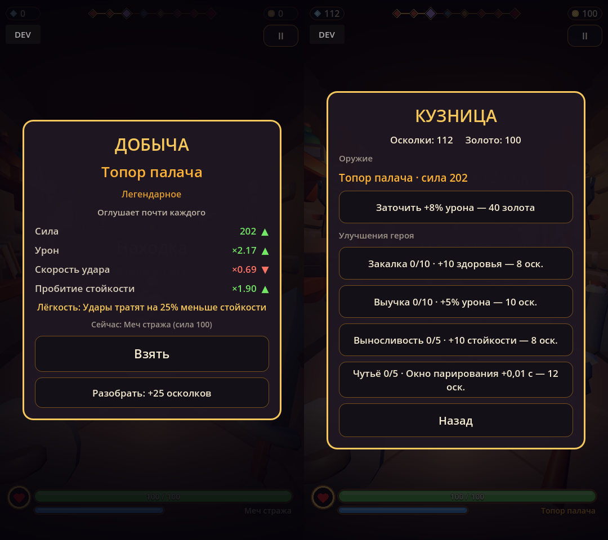

- **Выпадение:** после боя (30%), сундука (50%), последнего боя (60%) и босса (100%,
  не ниже эпического) выпадает оружие. Карточка сравнивает его с текущим:
  можно взять или разобрать на осколки.
- **5 видов:** меч стража, кинжал тени (быстрый), секира налётчика и топор палача
  (ломают стойкость), двуручник Зари (сильный заряженный удар).
- **4 редкости:** обычное, редкое, эпическое, легендарное — множитель урона и шанс свойства
  (Жатва, Острота, Лёгкость, Крушитель).
- **Кузница** (пауза **II** → «Кузница»): заточка оружия за золото и постоянные улучшения
  героя за осколки — здоровье, урон, стойкость, окно парирования.
- Осколки, золото, улучшения и оружие сохраняются между забегами (`user://save.json`).
- Все числа — в `data/items.json`.

## Настройки и стили графики
Кнопка **II** справа сверху — пауза и настройки: стиль графики, громкость, вибрация,
кузница. Стиль меняется на лету и сохраняется.

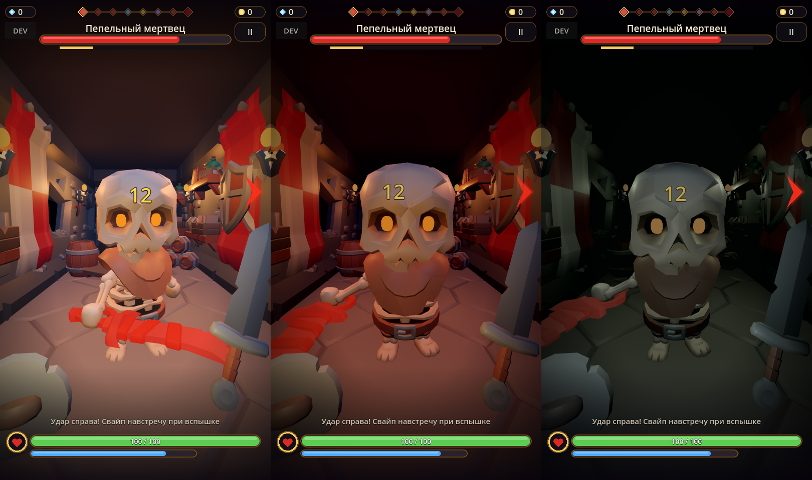

- **Пиксельный** — картинка собирается в крупные пиксели с ограниченной палитрой
  и дизерингом (`shaders/pixel.gdshader`).
- **Мультяшный** — исходный вид моделей KayKit, ярко и тепло.
- **Реалистичный** — каменная кладка и брусчатка Poly Haven (CC0) вместо мультяшных
  текстур, скелеты с человеческими пропорциями, приглушённые цвета, глубокие тени.
- **Жуткий** — то же, но почти без света и в холодном тумане.

Параметры стилей — в `scripts/settings.gd`. Запуск с нужным стилем: `-- --style=pixel`.

## Эффекты боя
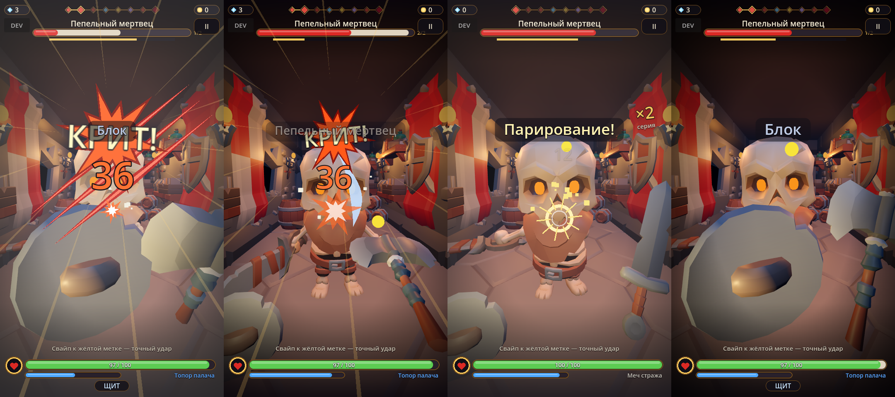

- **Крит:** точный удар с шансом 20% наносит ×1.8 — надпись «КРИТ!», лучи, вспышка экрана,
  крупная цифра, короткая «заморозка» кадра.
- След клинка цветом редкости оружия, звезда-вспышка в точке удара, осколки костей.
- Парирование — расходящееся кольцо с искрами; полученный удар — следы когтей со стороны атаки.
- Звёзды над оглушённым врагом, счётчик серии точных ударов.

## Меню разработчика
Есть только в debug-сборке (CI собирает именно её). Кнопка **DEV** слева сверху,
пока меню открыто — игра на паузе.

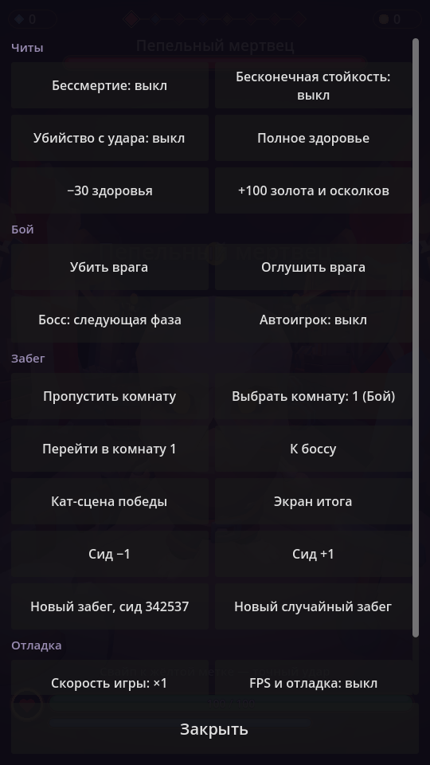

- **Читы:** бессмертие, бесконечная стойкость, убийство с одного удара,
  полное здоровье, −30 здоровья, +100 золота и осколков.
- **Бой:** убить или оглушить врага, следующая фаза босса, автоигрок прямо в игре.
- **Забег:** пропустить комнату, перейти в любую комнату, к боссу, к кат-сцене,
  к экрану итога; новый забег с выбранным сидом или случайный.
- **Отладка:** скорость игры ×0.25…×4, оверлей FPS / draw calls / памяти, состояния
  врага, времени до удара и последних распознанных жестов; проверка звуков и вибрации.

Флаги сохраняются при перезапуске забега.

## Разработка
```bash
godot --path .                              # запуск на ПК (мышь = палец)
godot --headless --path . -- --autoplay     # автоигрок проходит бой; код 0 = успех
godot --headless --path . -- --devtest      # автотест всех кнопок меню разработчика
```
CI собирает APK на каждый push (Actions → Artifacts; с `main` — Releases).

## Структура
```
scripts/game.gd      комната, камера, руки, ход боя, реакция на жесты
scripts/enemy.gd     враг: модель из примитивов, состояния, анимация, метка
scripts/gestures.gd  распознавание свайпов, двойного свайпа, удержания
scripts/hud.gd       полоски, стрелка удара, цифры урона, подсказки
scripts/sfx.gd       процедурный звук
scripts/dev_menu.gd  меню разработчика (только debug)
data/combat.json     параметры игрока и врагов, состав волны
tools/autoplay.gd    автоигрок для CI и меню разработчика
tools/dev_test.gd    автотест меню разработчика
```
